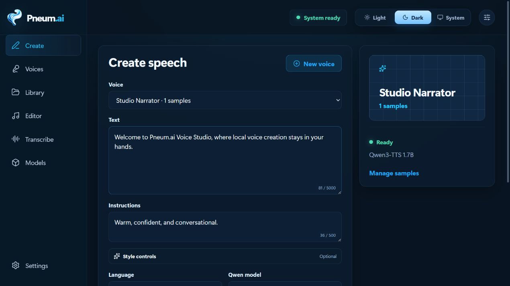
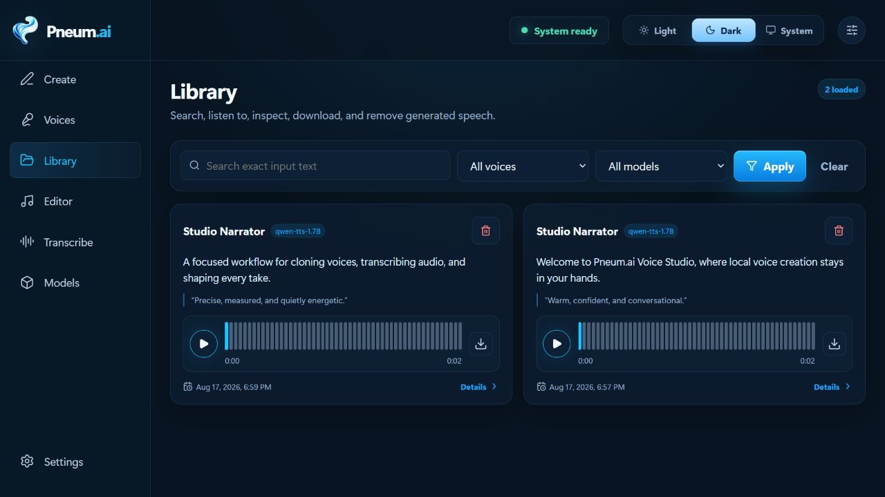

# Pneum.ai Voice Studio

A private, self-hosted workspace for voice cloning, streaming speech generation,
transcription, and lightweight audio editing.

Voice Studio combines a FastAPI service with a bundled React interface. It keeps voice
samples, model weights, generated audio, and metadata on your machine.



> [!IMPORTANT]
> Clone only voices you own or have permission to use. Model weights and third-party
> packages retain their own licenses.

## Status and supported runtime

`uv run voice-open` automatically installs and selects the runtime for your platform:

| Platform | Runtime |
| --- | --- |
| Apple Silicon Mac, macOS 14 or newer | MLX on the Apple GPU |
| Linux or WSL2 with NVIDIA and a CUDA 13-compatible driver | Nari on CUDA |

Both support streaming speech and concurrent requests. Python 3.12 is managed by `uv`.
Native Windows users run inside WSL2 for Nari; CPU-only hosts use the compatibility
command below.

The project is at version `0.1.0`. The API, data format, and model behavior may change before
the first stable release.

## Quick start

Install [uv](https://docs.astral.sh/uv/), clone the repository, and run:

```bash
git clone https://github.com/Pneum-ai/Voice-Studio.git
cd Voice-Studio
uv run voice-open
```

The same command works on Apple Silicon, Linux, and inside WSL2. It creates the Python
environment, installs the matching locked runtime, and starts the bundled web application.
No runtime flags or Node.js installation are needed.

Open [http://127.0.0.1:13337](http://127.0.0.1:13337). The first launch does not download
model weights. Open **Models** to download and load only the speech and transcription models
you want.

To load the configured default models during startup instead, run:

```bash
uv run voice-open --prewarm
```

### Windows with WSL2

Install an NVIDIA-enabled WSL2 distribution and `uv` inside it. Clone into the Linux
filesystem (for example, under `~/voice-studio`) and use the quick-start command above.

For a checkout on a Windows drive, the PowerShell helper manages Linux-owned Python
and SQLite storage:

```powershell
.\scripts\run_nari_windows.ps1
```

The launcher defaults to Debian, creates a persistent Linux-owned environment on first use,
and starts the UI. Choose another installed distribution with:

```powershell
.\scripts\run_nari_windows.ps1 -Distribution Ubuntu
```

The launcher stores SQLite in the WSL filesystem to avoid database locking problems under
`/mnt/c`; larger voice and model assets remain in the checkout.

## Hardware and resource requirements

Speech models download about **2.5 GB (0.6B)** or **4.5 GB (1.7B)** each, plus runtime
packages. First load can take several minutes. RAM and VRAM needs depend on the model
and workload; download size is not memory usage.

### Speech benchmarks

Audible startup **p50 / p95 in milliseconds** at one requested generation per second,
after warmup. Memory shows each test machine's capacity, not a minimum requirement.

| Hardware | Installed memory | 0.6B p50 / p95 | Peak in-flight | 1.7B p50 / p95 | Peak in-flight |
| --- | --- | ---: | ---: | ---: | ---: |
| Apple M5 Pro | 48 GB unified | 218 / 351 | 5 | 261 / 452 | 7 |
| RTX 3090 | 24 GB VRAM | 259 / 513 | 6 | 300 / 550 | 8 |
| RTX 4090 | 24 GB VRAM | 160 / 275 | 5 | Setup ran out of memory | — |
| RTX 5090 | 32 GB VRAM | 146 / 228 | 4 | 159 / 260 | 5 |
| RTX PRO 6000 Blackwell | 96 GB VRAM | 232 / 320 | 5 | 243 / 341 | 12 |
| H100 HBM3 | 80 GB VRAM | 173 / 288 | 4 | 168 / 285 | 5 |

Peak in-flight is the most outstanding requests observed, including warmup and queueing;
it is not a fixed concurrency setting or a maximum serving capacity.

Historical Base-model tests, with no calculated playback underruns in the successful
runs shown. Workloads and runtime versions differed; these are not a controlled hardware
comparison or CustomVoice results.

## First voice

1. Open **Models** and load a Qwen **Base** speech model.
2. Optionally load a transcription model for automatic reference transcripts.
3. Open **Voices**, create a profile, and add a clean reference recording.
4. Confirm that the transcript exactly matches the recording.
5. Open **Create**, enter text, and generate speech.
6. Download the result or save it to **Library**.

For built-in voices, load **Qwen3-TTS 1.7B CustomVoice** instead. In **Create**, select
that model and a built-in speaker, then optionally add delivery instructions such as
“Speak softly and slowly.” No profile or reference recording is needed. Base models
use cloned voices and do not support delivery instructions. Both modes support live
playback and saving to Library on MLX and NVIDIA/Nari.



## Other runtime modes

CPU with the official Qwen runtime:

```bash
VOICE_QWEN_ENGINE=official \
  uv run --no-group runtime --extra cpu voice-open
```

PowerShell uses the same CPU command with environment-variable syntax:

```powershell
$env:VOICE_QWEN_ENGINE="official"
uv run --no-group runtime --extra cpu voice-open
```

The API-only command does not serve browser assets:

```bash
uv run voice-open-api
```

## Configuration

Safe defaults work without a configuration file. Copy `.env.example` to `.env` when you need
an override. All settings use the `VOICE_` prefix.

Common settings:

| Setting | Default | Purpose |
| --- | --- | --- |
| `VOICE_HOST` | `127.0.0.1` | Bind address. Keep loopback unless adding access control. |
| `VOICE_PORT` | `13337` | HTTP port. |
| `VOICE_DATA_DIR` | `data` | Database, audio, models, and runtime state. |
| `VOICE_QWEN_ENGINE` | `nari` | PyTorch engine: `nari`, `official`, or compatibility `auto`; Apple Silicon selects MLX. |
| `VOICE_PREWARM` | `false` | Download and load default models at startup. |
| `VOICE_LOG_LEVEL` | `INFO` | `DEBUG`, `INFO`, `WARNING`, or `ERROR`. |

`.env.example` contains the complete operator-facing list. Command-line options override the
environment; run `uv run voice-open --help` to inspect them.

## Data and security

`data/` contains private voice samples, generated audio, the SQLite database, cached prompt
data, model weights, and managed runtimes. It is ignored by Git. Back it up deliberately and
do not attach it to issues.

Voice Studio binds to loopback and has no built-in user authentication. Before exposing it
to another device or network, put it behind authentication, configure TLS, and restrict CORS.
See [SECURITY.md](SECURITY.md) for reporting and deployment guidance.

## API

| URL | Purpose |
| --- | --- |
| `http://127.0.0.1:13337/v1` | Versioned resources |
| `http://127.0.0.1:13337/v1/audio` | OpenAI-compatible speech and transcription |
| `http://127.0.0.1:13337/health` | Process and inference readiness |
| `http://127.0.0.1:13337/docs` | Interactive API documentation |
| `http://127.0.0.1:13337/openapi.json` | Generated OpenAPI document |

Create a profile:

```bash
curl -X POST http://127.0.0.1:13337/v1/profiles \
  -H "Content-Type: application/json" \
  -d '{"name":"Example voice"}'
```

Add a reference sample using the returned profile ID:

```bash
curl -X POST \
  http://127.0.0.1:13337/v1/profiles/PROFILE_ID/samples \
  -F "audio=@sample.wav" \
  -F "transcript=The exact words spoken in the sample."
```

Generate streaming 24 kHz PCM using the OpenAI speech request shape. `voice` is
the Voice Studio profile ID:

```bash
curl http://127.0.0.1:13337/v1/audio/speech \
  -H "Content-Type: application/json" \
  -d '{"model":"qwen-tts-1.7B","input":"Hello.","voice":"PROFILE_ID","response_format":"pcm"}' \
  --output speech.pcm
```

Transcribe with the OpenAI multipart field names:

```bash
curl http://127.0.0.1:13337/v1/audio/transcriptions \
  -F "file=@speech.wav" \
  -F "model=whisper-turbo"
```

The OpenAI-compatible routes are the recommended integration surface. The
legacy Voice Studio routes remain available for the bundled UI and existing
clients. See the [API v1 contract](docs/api-v1.md) for complete details.

## Development

Install the backend and frontend development dependencies:

```bash
uv sync --group dev
npm --prefix ui ci
```

On a machine without the supported CUDA runtime:

```bash
uv sync --no-group runtime --extra cpu --group dev
```

Run every repository gate:

```bash
uv run --group dev -- python -m scripts.verify
```

The verifier checks formatting, linting, types, source policy, backend tests, frontend tests,
the production UI build, and the distributable wheel contents. Hardware inference and model
downloads remain opt-in.

Frontend development uses a separate Vite process:

```bash
uv run voice-open-api
npm --prefix ui run dev
```

`npm --prefix ui run build` writes the release UI into `app/ui_dist/`. Commit those generated
assets when the UI changes so source checkouts and Python wheels do not require Node.js.

See [CONTRIBUTING.md](CONTRIBUTING.md) before changing public APIs or storage.

## Distribution

Build the UI and Python artifacts from a clean checkout:

```bash
npm --prefix ui ci
npm --prefix ui run build
uv build
```

The wheel contains the application, production UI, and the modified Nari engine source. It
does not contain model weights, voice data, local evaluation profiles, raw benchmark results,
or CUDA binaries. Install the appropriate runtime extra for the target host.

Before publishing, run the complete verifier and review
[THIRD_PARTY_NOTICES.md](THIRD_PARTY_NOTICES.md).

## Documentation

- [Architecture and storage](docs/architecture.md)
- [API and WebSocket contract](docs/api-v1.md)
- [Checked OpenAPI document](docs/openapi-v1.json)
- [Changelog](CHANGELOG.md)

## License

Copyright (c) 2026 the Pneum.ai Voice Studio contributors.

Voice Studio is licensed under [Apache-2.0](LICENSE). Third-party code and model weights
retain their own licenses, including MIT for the MLX Audio-derived code. See
[THIRD_PARTY_NOTICES.md](THIRD_PARTY_NOTICES.md) for attribution.
